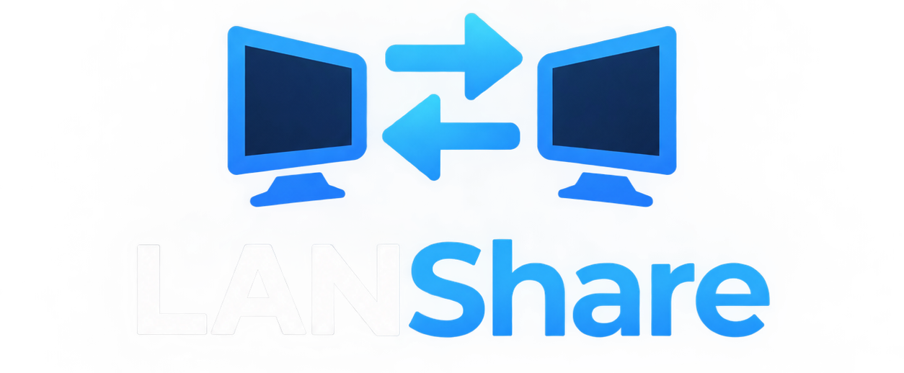

# LANShare

LANShare is a local network application designed to share a computer's screen with other devices in real time. It aims to provide low-latency screen streaming over a LAN connection, with support for multiple users, multiple monitors, and specific window sharing.

The project is being developed with performance, stability, and ease of use in mind, with future plans to include synchronized audio streaming and support for higher resolutions and frame rates.

---

## 📦 Download

  
  
  

Looking for an older version? Check the [GitHub Releases](../../releases) page.

**Prerequisites:**
> The host and client PCs must be connected to the same LAN (Local Area Network) for LANShare to work. If the PCs are on different networks, you can use a VPN application such as Hamachi, Radmin VPN, or another alternative to create a virtual LAN.

---

## 📋 License

Copyright (C) 2026 ArtMMS

LANShare is free software: you can redistribute it and/or modify it under the terms of the **GNU General Public License v3.0** as published by the Free Software Foundation, either version 3 of the License, or (at your option) any later version.

In short: you are free to use, study, modify, and distribute LANShare, including commercially. However, if you distribute a modified version or a work based on it, you must release its source code under the same GPLv3 license and keep the copyright notices.

LANShare is distributed in the hope that it will be useful, but WITHOUT ANY WARRANTY. See the [LICENSE](LICENSE) file for the complete license terms.

> Versions released before v1.2.x remain available under the MIT License.

---

## ☕💙 Support LANShare

LANShare is an open-source and free-to-use project. If you find LANShare useful and would like to support its development, consider sponsoring the project.

Your support helps with development, maintenance, testing, and future improvements.

